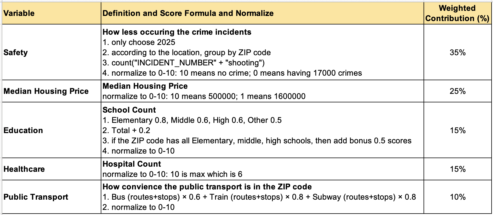

# Boston Habitability Map by ZIP Code

IE 6600 Computation and Visualization (Northeastern University) — Project 2

The project scores how livable each Boston ZIP code is. Five scores from 0 to 10 (safety, median housing price, education, healthcare and public transport) are built from public data in Python, combined into a weighted overall score, and mapped in Tableau. Population density per ZIP code is also extracted; it is not part of the overall score.

## Results

From the "overall score" cell of [`boston_habitability.ipynb`](boston_habitability.ipynb) (27 ZIP codes). The notebook prints ZIP codes without the leading zero; they are written with five digits here.

| ZIP | Overall | Safety | Housing | Education | Healthcare | Transit |
|---|---|---|---|---|---|---|
| 02114 | **6.78** | 8.72 | 6.46 | 0.00 | 10.00 | 6.14 |
| 02215 | **6.57** | 10.00 | 8.47 | 1.33 | 5.00 | 0.00 |
| 02115 | **6.26** | 7.41 | 5.95 | 1.19 | 6.67 | 10.00 |
| 02124 | 5.93 | 5.55 | 9.12 | 6.81 | 1.67 | 4.31 |
| 02132 | 5.79 | 8.41 | 8.27 | 2.74 | 1.67 | 1.17 |
| 02113 | 5.77 | 7.89 | 8.23 | 0.74 | 0.00 | 8.37 |
| 02135 | 5.77 | 4.72 | 8.57 | 4.67 | 3.33 | 7.79 |
| 02130 | 5.45 | 4.99 | 7.84 | 6.15 | 3.33 | 3.18 |
| 02134 | 5.34 | 7.21 | 9.29 | 0.74 | 0.00 | 3.84 |
| 02129 | 5.26 | 8.31 | 6.48 | 2.59 | 1.67 | 0.88 |

- Overall score: highest 6.78, lowest 2.44, mean 4.93, median 5.05. No ZIP code scores 8 or more; 3 score 6–8, 19 score 4–6 and 5 score 2–4. The lowest is 02118 (South End), whose safety score is 0.00 (all 27 rows are in [`Boston_Data_All_Final.csv`](Boston_Data_All_Final.csv)).
- **Safety:** 74,837 crime reports in 2025, of which 70,213 were assigned to a ZIP code (484 shootings). Safest: 02110 Financial District (604 incidents, score 8.99). Least safe: 02118 (7,594 incidents, score 0.00) and 02121 Dorchester (5,146 incidents, 108 shootings, score 1.24).
- **Education:** 154 schools in Suffolk County; 9 of the 25 ZIP codes in the school list have elementary, middle and high schools. 02119 Roxbury has the most schools (15, score 10.00).
- **Transit:** the MBTA GTFS feed has 10,276 stops and 395 routes. Highest: 02115 Fenway/Kenmore (10.00), 02108 Beacon Hill (8.74), 02113 North End (8.37).
- **Healthcare:** 02114 has the most hospitals (6, score 10.00).



## Approach

Each score is computed in its own notebook section and saved as a CSV/XLSX file; the files are then merged on ZIP code.

| Score (weight) | Data | Method |
|---|---|---|
| Safety (35%) | Boston crime incident reports, 2025 only | Each incident is assigned to the nearest of 25 ZIP centre points (haversine distance, within 3 miles). Unsafe count = incidents + shootings. Score = 10 × (1 − count / 6000), clipped to 0–10. |
| Housing price (25%) | Median home value per ZIP code | Linear: $500,000 → 10, $1,600,000 → 1, clipped to 1–10. |
| Education (15%) | NCES public school list, Suffolk County | Schools are grouped by grade range into Elementary / Middle / High / Other. Raw = 0.8·E + 0.6·M + 0.6·H + 0.5·Other + 0.2·total, +0.5 if the ZIP has all of E, M and H; scaled to 0–10 by the maximum. |
| Healthcare (15%) | Boston hospital list | Hospital count / 6 (the maximum) × 10. |
| Transit (10%) | MBTA GTFS feed | Stops are assigned to ZIP codes within a radius of 0.5–1.5 miles of the ZIP centre (a stop can count for several ZIPs); routes per stop come from `stop_times` and `trips`. Raw = 0.6·(bus routes + stops) + 0.8·(train routes + stops) + 0.8·(subway routes + stops), where "train" includes subway, light rail and commuter rail; scaled to 0–10 by the maximum. |

Overall score = 0.35·Safety + 0.25·Housing + 0.15·Education + 0.15·Healthcare + 0.10·Transit. Before the merge, ZIP codes 02150, 02151, 02152 and 02467 are removed, and a missing score is set to 0.

## Repository contents

```
boston_habitability.ipynb               # notebook: all scores, merge and overall score, with outputs
Boston_Data_All_Final.csv               # final table: all scores + Overall_Score for 27 ZIP codes
Boston_safety_score.csv                 # safety score per ZIP
Boston_median_housing_price_score.csv   # housing price score per ZIP
Boston_school_scores.csv                # education score per ZIP
boston_school_level.xlsx                # schools with grade-level class (intermediate file)
Boston_hospital_score.xlsx              # hospital count and score per ZIP
Boston_transit_scores.csv               # stops, routes and transit score per ZIP
Boston_popu_density.csv                 # population and density per ZIP (Suffolk County)
boston_median_housing_price.xlsx        # input: median home value per ZIP
boston_school_data.xlsx                 # input: NCES school list (phone column removed)
hospitals.csv                           # input: Boston hospital list (contact names and phone numbers removed)
tableau/
├── Score_Definition.xlsx               # score definitions, weights and data source links
├── images/                             # score-definition table and score colour icons made for Tableau
└── zip_codes/                          # Boston ZIP code boundaries (shapefile) and zip_codes.csv; not read by the notebook
```

## How to run

1. Install the packages in [`requirements.txt`](requirements.txt). The notebook was run with Python 3.8 in Jupyter. It reads and writes all files in its own folder.
2. Three large inputs are **not included**. Download them into the repository folder before running the sections that need them:

| File the notebook expects | Used for | Source |
|---|---|---|
| `boston_crime_data.csv` (about 42 MB) | Safety | Analyze Boston, Crime Incident Reports: https://data.boston.gov/dataset/crime-incident-reports-august-2015-to-date-source-new-system/resource/b973d8cb-eeb2-4e7e-99da-c92938efc9c0 |
| `MBTA_GTFS.zip` (about 36 MB; unzipped to `MBTA_data/`) | Transit | MBTA GTFS feed: https://www.mbta.com/developers/gtfs |
| `population_density.xlsx` | Population density | simplemaps US ZIP code database: https://simplemaps.com/data/us-zips (saved as .xlsx). Its license does not allow redistributing the database. |

Sources of the included inputs (from `tableau/Score_Definition.xlsx`):
- Median home value: https://simplemaps.com/city/boston/zips/home-value
- Schools: [NCES Common Core of Data school search, Massachusetts, Suffolk County](https://nces.ed.gov/ccd/schoolsearch/school_list.asp?Search=1&InstName=&SchoolID=&Address=&City=&State=25&Zip=&Miles=&County=Suffolk+County&PhoneAreaCode=&Phone=&DistrictName=&DistrictID=&SchoolType=1&SchoolType=3&SchoolType=4&SchoolType=2&SpecificSchlTypes=all&IncGrade=-1&LoGrade=-1&HiGrade=-1) (2023–24 / 2024–25 data)
- Hospitals: Analyze Boston, Hospitals: https://data.boston.gov/dataset/hospitals/resource/9ce5935a-bc4f-4a5c-a063-0f15fc01513a
- ZIP code boundaries: City of Boston GIS portal (service `Planning/OpenData/MapServer/1`, according to the shapefile metadata)

The crime and GTFS files used for the results are dated December 2025. A new download will give different 2025 counts.

**Notes**
- The score-definition table says a safety score of 0 means 17,000 crimes. The notebook code uses 6,000 (`MAX_CRIME = 6000`), and the saved scores follow the code.
- 02210 and 02215 are not among the 25 ZIP centre points used for crime and transit. The notebook adds both to the safety table by hand with 0 incidents and a safety score of 10, and their transit score is 0.
- Sheet `工作表2` of `Score_Definition.xlsx` has slightly different safety values (shootings weighted 0.2, which is commented out in the notebook). The results above are from the notebook.
- The safety section saves `boston_safety_score.csv` but the merge step reads `Boston_safety_score.csv`. This works on macOS (case-insensitive file names); on Linux, rename the file.
- The Tableau workbook is not part of this repository.
